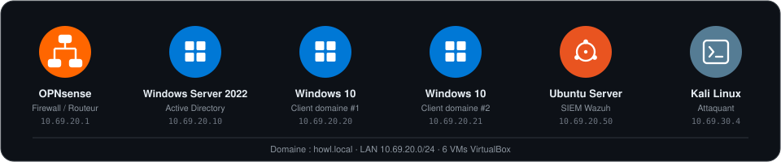

# Hamed Louma

  

Élève ingénieur réseaux et cybersécurité, actuellement stagiaire dans l'équipe NRE de Worldline sur l'observabilité des infrastructures. Je m'intéresse à l'automatisation d'infrastructure, au monitoring et à la fiabilité des systèmes.

## 🖥️ Homelab

*Infrastructure personnelle de test et d'entraînement*

## Compétences Techniques

**Observabilité & Infrastructure** — Grafana • Prometheus • PromQL • Graylog • PagerDuty • GitLab CI/CD • NetBox • Python / APIs REST

**Réseau & Système** — Linux (Kali / Debian) • Windows Server • Active Directory • VMware / VirtualBox • OPNsense / pfSense • Cisco (VLAN, OSPF) • Fortinet • Palo Alto

**Sécurité** — Wazuh SIEM • Analyse de logs • Détection d'intrusion • Incident Response • Pentest Web (SQLi / XSS) • OWASP Top 10 • Nmap • Burp Suite • Metasploit

**Développement & Outils** — Python • Bash • Git / GitHub

## Certifications

- 🛡️ SecNumacadémie MOOC — ANSSI

## Formation

**Ingénieur Cybersécurité — BAC+5**
ESAIP Angers | 2023 - 2027

**Erasmus+ — Universidad de Castilla-La Mancha**
Albacete, Espagne | 2025 - 2026

**Erasmus+ — Université de Veliko Tarnovo**
Bulgarie | 2023 - 2024

**Classe Préparatoire MPSI**
Libreville, Gabon | 2021 - 2023

---

### 📫 Let's Connect

À la recherche d'un stage de fin d'études (PFE — 6 mois) en observabilité, automatisation d'infrastructure, réseaux & systèmes, à partir de février 2027.

